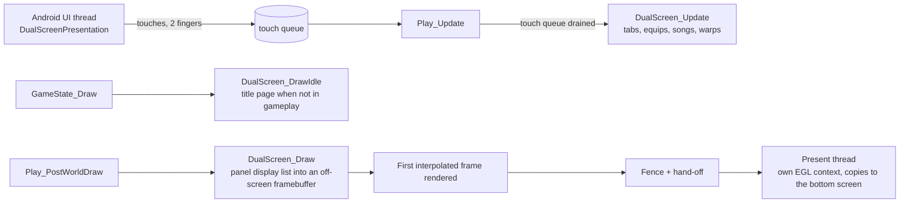

# 2S2H Dual Screen: what's built (as of v41, 2026-11-20)

This is a custom build of the linkzenic 2S2H Android fork (v5.0.1-android.3). It turns the AYN Thor's bottom screen into an MM3D-style touch screen for Majora's Mask, with everything drawn in the game's own art and font.

- **App:** "2 Ship Dual Screen" (`com.twoshipfork.mm.dualscreen`). It installs alongside the regular 2S2H, and both share `/sdcard/2S2H` (saves, settings, mods). Run only one of them at a time.
- **Latest APK:** `~/android-dev/2Ship-DualScreen-v41.apk`
- **Source:** `~/android-dev/2ship`, branch `dualscreen` (18 commits; libultraship submodule also on a `dualscreen` branch)
- **Install, mods and settings:** [2S2H-DualScreen-Setup.md](SETUP.md)
- **Progress tracker:** [2S2H-DualScreen-Roadmap.md](ROADMAP.md)

---

## Using it

### The strip along the bottom (always visible)

- **Left:** the day label and the current time, in the Bombers' Notebook digits.
- **Middle:** the tabs: Items · Masks · Songs · Map · Quest Log · Notebook, plus Checks in rando saves. Any tab can be hidden in the settings. The open tab gets a gold ring, and the tab grows while pressed.
- **Right:** a moon icon and the time left before the moon falls. It turns red in the final 6 hours.
- **Above the strip:** a thin three-day timeline that fills as time passes. The Final Day is in red. While the Inverted Song of Time is active, the timeline and countdown turn blue.

### Items and Masks

- The pause menu's 24-slot grids show:
  - ammo counts
  - items your current form can't use, greyed out
  - the pause menu's frame around anything equipped
  - masks given away on the moon, hidden
- On the right is a controller in the Thor's Nintendo layout:
  - X (C-Left) on top, Y (C-Right) on the left, RB (C-Down) on the shoulder
  - A and B for orientation, with B showing your sword
  - the four D-pad slots (when 2S2H's D-pad equips are on)
- **Equip:** tap an item, then tap a button, or drag the item onto a button. This uses the pause menu's own equip logic, so swaps, magic arrows on the bow, and "can't remove a mask you're wearing" all behave as in the pause menu.
- **Use:** touch a filled button to press it in-game for as long as your finger stays down. A tap uses the item once, and holding works like holding the real button. It can be switched off with "Use Items From Second Screen".

### Songs

- **Top row:** boss remains, sword, shield, quiver, bomb bag and wallet.
- **Music guide:** 12 songs with their names, each written in the buttons you press (X / Y / RB letters, A and C-Up). Unlearned songs show only a faint name.
- **Play:** tap a learned song and Link plays it on the ocarina automatically (the same mechanism as 2S2H's Song Items).

### Map

- The world map, painted HD by the MM Reloaded pack, shows:
  - a pulsing marker for Link's region
  - your activated owl statues
  - Tingle-map clouds over unexplored regions
- **Navigation:** pinch or + / − to zoom (up to 4x) and drag to pan. The red-dot button recentres on Link.
- **Clouds:** the cloud button (or the "Second Screen Map Clouds" option) shows the whole map instead.
- **Inside a temple:** the Map tab becomes the temple's floor map, as in the pause menu: rooms (visited ones filled, the current one pulsing), doors, and with the compass the chests and boss door. Link is a red dot. Floor buttons on the left (tap one to look at it; Link's floor has a red dot, the boss's a skull). The map, compass, boss key, small keys and stray fairies (x/15) are down the right.
- **Warp:** tap an owl, then **Warp**. This needs the Song of Soaring and is blocked where the game forbids it.

### Quest Log

- **Main Quest:** Clock Town, Woodfall, Snowhead, Great Bay, Ikana and the Moon, each with step dots (gold when done) and the next objective. Progress comes from your save.
- **Masks:** all 24 masks; missing ones show as dark outlines. Tap one for its name and status.
- **Side Quests:** this cycle's progress on Anju and Kafei, Romani Ranch, the Old Lady and the Postman, read from the notebook's flags (they reset with the Song of Time).
- **Collection:** pieces of heart, stray fairies, both Skulltula houses, Bombers' Notebook people, masks and the bank.
- **Guides:** tap a quest or side quest for its guide: every step with a gold stamp when done, the next step highlighted, when it can be done, and the items it needs (faded until you have them).
- **Hints:** the **Lens of Truth** button reveals a short hint for the selected entry in a box along the bottom. Hints stay hidden until you ask.

### Notebook

- The real Bombers' Notebook: the same 20 people, schedules and stamps as the in-game one. Swipe up or down to scroll.
- **Tap a portrait** to read who they are, or **tap a stamp** to read that event. It's the game's own text, in a box at the bottom.
- With nothing picked, a **Next** line shows the soonest appointment today for people you've met. One already under way reads **Now … until** its end time.

### Checks (randomizer saves only)

- Opens on the area Link is in, with the run's total at the top right.
- **< Areas** lists every area with done / total (finished areas in gold, Link's area marked red). Drag to scroll, tap an area to see its checks; collected ones get a stamp.

### Over every page

- **Target info:** while you Z-target an enemy, a card in the game's dialogue-box style shows a live 3D portrait of it, its name and a health bar (gold edges for bosses).

### Gyro aiming (Android)

- With first-person gyro aiming on, the device's own gyro is mapped automatically. It's read at 200 Hz and measured around the real vertical, so turns add back up properly. A sensitivity of 0.72 is 1:1 with your actual rotation.
- **FPS and input** (off by default): a bar above the strip with the real frame rate, the stick and the buttons you're holding.

### Left-handed

- Puts the controller on the left of the Items and Masks pages, the grid on the right, and reverses the tab order.

### Timeline

- **The tab (sun icon):** one day at a time (1st / 2nd / Final, opening on today), from 6:00 to 6:00, with your remains and the hours left. Day and night are shaded, the past is dimmed, and a sun or moon marks now. A full notebook scrolls.
- **Appointments:** the Bombers' Notebook appointments of people you've met sit on each day as bars with their portrait, gold once done. Tap one to read it.
- **Double Time:** tap a later hour for "Skip to …", then **Double Time** to play the song and jump there (needs the Song of Time and 2S2H's Better Song of Double Time).
- **On the strip:** a day/night timeline with a red marker for now; tap it to open the Timeline. The moon icon grows as the end nears.

### Outside gameplay

- On the title and file-select screens, the bottom screen shows the Zelda / Majora's Mask logo on parchment.

### Settings (2S2H menu, next to Bow Reticle)

| Option | Default | What it does |
|---|---|---|
| Second Screen Panels | on | Everything on the bottom screen |
| Second Screen Map Clouds | on | Tingle clouds on the map (also the map's cloud button) |
| Use Items From Second Screen | on | Touching a filled button presses it in-game |
| Second Screen Target Info | on | Name and health of the Z-targeted enemy |
| Second Screen FPS and Input | off | Frame rate and held buttons on the bottom screen |
| Second Screen Left-Handed | off | Controller on the left, tabs reversed |
| Second Screen Tab: … | on | One per tab; hides that tab |

The Quest Log's hint state is remembered between sessions (`gEnhancements.DualScreen.QuestHints`).

---

## How it works

### Files

- **`mm/2s2h/Enhancements/DualScreen/DualScreen.cpp`:** Android/EGL side:
  - the panel framebuffer
  - the touch queue
  - the present thread (EGL fence hand-off, vsync on its own thread)
  - the song-request hooks
- **`DualScreenPanels.c`:** every page:
  - text in the game font (`fontTbl` + `sNESFontWidths`)
  - tabs and strip
  - equip / use / songs / map / quest log / notebook
  - texture warm-up
- **`DualScreenRando.cpp`:** rando checks grouped by area, cached per file.
- **`DualScreen.h`:** the shared interface.
- **Java:** `DualScreenManager` finds the presentation display. `DualScreenPresentation` provides a non-focusable SurfaceView, so controller focus stays on the game.
- **Hooks in the game:**
  - `z_play.c` (update + draw)
  - `game.c` (idle page)
  - `BenPort.cpp` (present after the first interpolated frame; audio buffer)
  - the pause menu's equip logic, split out as `KaleidoScope_ApplyItemEquip` / `KaleidoScope_ApplyMaskEquip`
- **libultraship:** texture cache raised from 1024 to 4096 entries for HD packs.

### Things learned the hard way

- **Canvas units:** the panel framebuffer must be created at canvas size (640 × 557) with `resize=true`. libultraship maps draw coordinates against `orig_width` / `orig_height`.
- **Scissor:** scissor rectangles are flipped vertically inside off-screen framebuffers. Always use `Panel_SetScissor`.
- **Interpolation replays:** frame interpolation replays the display list several times per game frame. The panel is cut out after the first replay (`DualScreen_SkipPanelReplays`).
- **Item ID order:** mask item IDs aren't in inventory-slot order. Use the slot→item table.
- **Large textures:** RGBA32 images like the title logo must be loaded as one clamped tile, as 2S2H's HD title screen does.

### Dev loop

`~/android-dev/tools/ds.sh build | install [force] | shot [bot|top] [scale] | tap X Y | swipe X1 Y1 X2 Y2 | log`. Coordinates are canvas units, and screenshots are downscaled to save tokens. The full resume steps are in the roadmap.

---

## Status

**Verified on the Thor:**
- all tabs render
- tab switching
- drag and tap equip
- mask transform and the worn-mask rule
- touch-use
- song playback (Song of Healing)
- the Quest Log and its hints
- map zoom / pan / recentre and the clouds toggle
- the title page
- 116 FPS on the top screen with no janky frames

**Not verified yet:**
- **Target info card:** no enemy was reachable during the test.
- **Bow hold-to-aim from the touch screen:** only taps have been tested.

**Audio:** the choppiness is fixed (v38). The audio thread now catches up when its queue runs low, and the render loop drops an in-between frame instead of letting the game fall behind. Diagnostics: `gDebug.AudioDiag` (see the roadmap's progress log).
